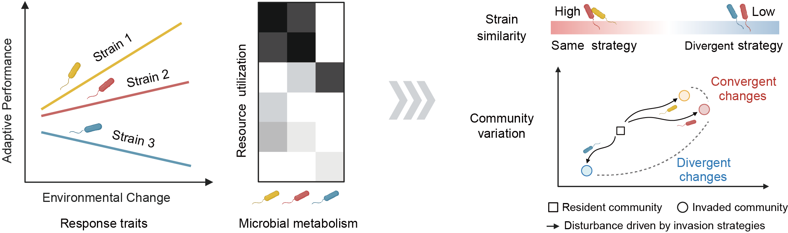

```{r setup, include=FALSE}
knitr::opts_chunk$set(echo = TRUE)
# Clean workspace
rm(list=ls()) 
# Set output directory
output_dir="./"
```

## A. Hypothetical illustration

A)  Illustration of the hypothesized drivers of resident community shifts induced by intraspecific invader variation.

This figure was created with BioRender. Jiang, G. (2026) <https://BioRender.com/3zdhh6i>.



## B. Distribution of observations

（B）Geographic distribution of paired observations included in the meta-analysis. The map was based on the standard map No. GS(2021)648 and Antarctica is not shown.

```{r geomap, echo=TRUE}
library(sf)
library(ggplot2)
library(vroom)
library(dplyr)
world_map <- st_read(
  "./word-map.shp",quiet = TRUE) %>% 
  filter(NAME != "Antarctica")

map_data <- vroom("map.csv")
map_data$group <- factor(map_data$group,
                         levels = c("Rastonia solanacearum","Fusarium oxysporum","Meloidogyne"))
map_sf <- st_as_sf(
  map_data,coords = c("longitude", "latitude"),
  crs = 4326,remove = FALSE)


fig1b = ggplot() +
  geom_sf(data = world_map,fill = "#dcd8c7",
          colour = "white",linewidth = 0.1)+
  geom_sf(data = map_sf,
          aes(fill = group),colour = "black",
          size = 1,pch=21)+
  scale_x_continuous(breaks = seq(-180, 200, 45), labels = function(x){paste0(x, "°")},limits = c(-180,200)) +
  scale_y_continuous(breaks = seq(-60, 100, 30), labels = function(x){paste0(x, "°")}) +
  scale_fill_manual(values = c("#e20612","#ffd401","#00b0eb"))+
  labs(fill="")+
  theme_classic() +
  theme(axis.title = element_blank(),axis.text = element_blank(),
        axis.line = element_blank(),axis.ticks = element_blank(),
        legend.position = c(0.15,0.3))

ggsave(paste0(output_dir, "fig1B.pdf", sep=""), fig1b, width = 9, height = 5)
fig1b
```

## C. Meta-analysis

（C）Forest plot displaying the impact of microbial invasion on the resident community for the three pathogen species included in the meta-analysis.

```{r meta}
library(metafor)
library(magrittr)
library(ggplot2)
library(wesanderson)
library(dplyr)
library(tidyr)
library(purrr)
library(tibble)

alpha_meta=read.table("alpha_meta.txt",header = T,sep="\t")
bacterial=read.table("bacterial_pcoa.txt",header = T,sep="\t")
fungl=read.table("fungl_pcoa.txt",header = T,sep="\t")
nematode=read.table("nematode_pcoa.txt",header = T,sep="\t")

calculate_distance <- function(d, disease_name) {
  control <- d %>% filter(Group == "Control") %>%
    drop_na(PC1, PCC2) %>% select(PC1, PCC2)
  treatment <- d %>% filter(Group == "Treatment") %>%
    drop_na(PC1, PCC2) %>% select(PC1, PCC2)
  
  within_distance <- function(x) {
    if (nrow(x) < 2) {return(numeric(0))}
    as.numeric(dist(x))
    }
  control_within <- within_distance(control)
  treatment_within <- within_distance(treatment)
  if (nrow(treatment) > 0 && nrow(control) > 0) {
    between_distance <- as.vector(
      sqrt(outer(treatment$PC1, control$PC1, "-")^2 +
             outer(treatment$PCC2, control$PCC2, "-")^2))
  } else {
    between_distance <- numeric(0)
  }
  
  all_within <- c(treatment_within,control_within)
  get_mean <- function(x) {
    if (length(x) > 0) mean(x) else NA_real_
  }
  
  get_sd <- function(x) {
    if (length(x) > 1) sd(x) else NA_real_
  }
  
  tibble(Disease = disease_name,Index = c("beta", "structure"),
         n.e = c(length(treatment_within),length(between_distance)),
         mean.e = c(get_mean(treatment_within),get_mean(between_distance)),
         sd.e = c(get_sd(treatment_within),get_sd(between_distance)),
         n.c = c(length(control_within),length(all_within)),
         mean.c = c(get_mean(control_within),get_mean(all_within)),
         sd.c = c(get_sd(control_within),get_sd(all_within)))
}

#
distance_result <- imap_dfr(
  list(Bacteria = bacterial,Fungi = fungl,Nematode = nematode),
  function(data, disease_name) {
    data %>%
      group_by(ID, Auther, Year) %>%
      group_modify(~ calculate_distance(.x, disease_name)) %>%
      ungroup() %>%
      select(ID, Disease, Index,n.e, mean.e, sd.e,n.c, mean.c, sd.c)
  }
)

meta_data <- rbind(alpha_meta,distance_result) %>% na.omit()

Response_ratio <- matrix(nrow = 9,ncol = 9) %>% as.data.frame()
colnames(Response_ratio) <- c("Disease","Index","effect","lower","upper","meta.p","hetero","het.p","group")
row_id <- 1

for(i in c("Bacteria","Fungi","Nematode")) {
      for(j in c("alpha","structure","beta" )){
        dat <- meta_data[meta_data$Disease==i & meta_data$Index==j,]
        dat <- escalc(measure = "ROM",
                      m1i = mean.e, sd1i = sd.e, n1i = n.e,
                      m2i = mean.c, sd2i = sd.c, n2i = n.c,data = dat)
        model <- rma(yi = yi,vi = vi,data = dat,method = "REML")
        Response_ratio[row_id, ] <- data.frame( Disease = i,Index = j,
                                                effect = as.numeric(coef(model)),
                                                lower = model$ci.lb,upper = model$ci.ub,
                                                meta.p = model$pval,
                                                hetero = model$I2,het.p = model$QEp,group = paste(i, j, sep = "_"))
        row_id <- row_id + 1
      }
}

Response_ratio$group <- factor(Response_ratio$group,
                               levels = rev(c("Bacteria_alpha","Bacteria_beta","Bacteria_structure",
                                          "Fungi_alpha","Fungi_beta","Fungi_structure",
                                          "Nematode_alpha","Nematode_beta","Nematode_structure")))

fig1c <- ggplot(Response_ratio)+
  annotate("rect",xmin = -1, xmax = 3, ymin = 9.5, ymax = 6.5,fill="#e2061210")+
  annotate("rect",xmin = -1, xmax = 3, ymin = 6.5, ymax = 3.5,fill="#ffd40110")+
  annotate("rect",xmin = -1, xmax = 3, ymin = 0.5, ymax = 3.5,fill="#00b0eb10")+
  geom_vline(aes(xintercept=0),lty=2,linewidth=.5,color="gray")+
  geom_errorbar(data=Response_ratio,aes(x=effect,y=group,xmax=upper,xmin=lower,color=Index),width=0)+
  geom_point(data=Response_ratio,aes(y=group,x=effect,color=Index),size=2.5)+
  scale_y_discrete(labels=rep(c("Community structure","Beta diversity","Alpha diversity"),3))+
  scale_x_continuous(limits = c(-1,3))+
  theme_classic()+
  scale_color_manual(values =  wes_palette(n=3, name="GrandBudapest2"))+
  theme(axis.line.y = element_blank(),
        axis.ticks.y = element_blank(),
        legend.position = "none")+
  labs(x="Response ratio (log)",y="")
ggsave(paste0(output_dir, "fig1C.pdf", sep=""), fig1c, width = 4, height = 4)
fig1c
```
